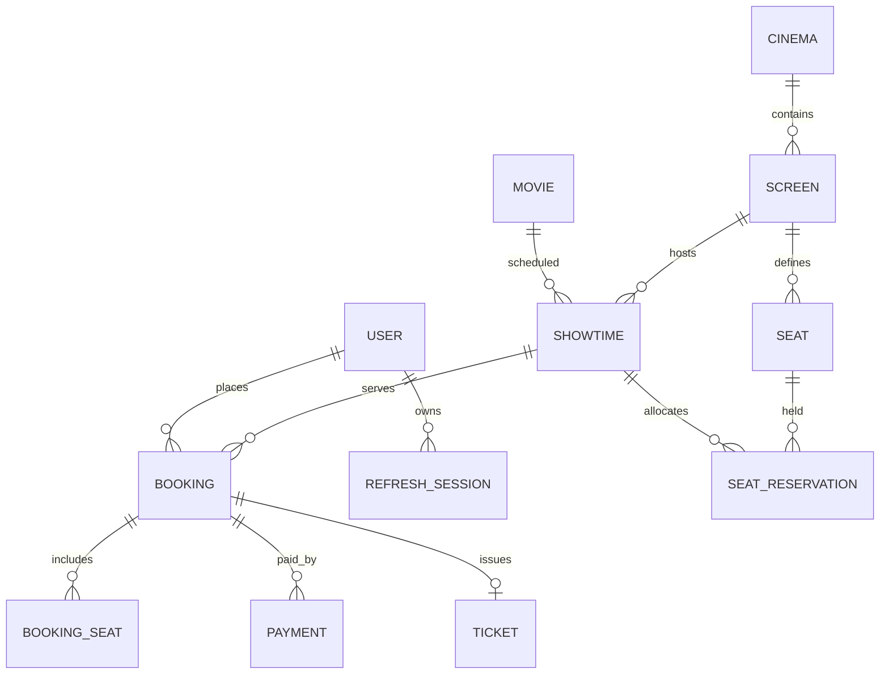

# Phase 2: PostgreSQL + Prisma migration foundation

## Scope

This document records the Phase 2 checkpoint. At that checkpoint, PostgreSQL was prepared but not yet the runtime database. The later full-stack implementation switches the application repositories to PostgreSQL/Prisma and adds transactional booking/payment flows. No live database was provisioned or migrated in this workspace. Run the importer without `--apply` first; it is dry-run by default.

The implementation uses Prisma ORM 7.10.1. In Prisma 7, datasource URLs live in `prisma.config.ts`, Client generation requires an explicit output path, and PostgreSQL access uses a driver adapter. See [Prisma PostgreSQL setup](https://www.prisma.io/docs/orm/v7/core-concepts/supported-databases/postgresql), [Prisma Client generation](https://www.prisma.io/docs/orm/v7/prisma-client/setup-and-configuration/generating-prisma-client), and [Prisma config reference](https://www.prisma.io/docs/orm/v7/reference/prisma-config-reference).

## ERD

## Relational mapping

| MongoDB source | PostgreSQL target | Migration treatment |
|---|---|---|
| `users` | `users` | UUID primary key; retain ObjectId in `legacy_id`; normalize email; preserve password hash; assign `USER` role. Duplicate username/email records are quarantined. |
| `movies` | `movies` | Keep ObjectId in `legacy_id`; map title/genre/year/description/poster/duration. |
| `movies.showtimes[].cinema` | `cinemas` | Deduplicate by normalized cinema name. Legacy names do not contain reliable IDs or addresses. |
| `movies.showtimes[].times[]` | No `showtimes` rows | Times have no date, screen or canonical schedule; do not invent them. Create real schedules after cinemas/screens/seats are configured. |
| `bookings` | `bookings`, `booking_seats` | Keep ObjectId and display snapshots; map user and unambiguous movie/cinema references. Preserve raw date/time strings. Mark as `LEGACY_UNVERIFIED`. |
| `bookings.seats[]` | `booking_seats` | One row per label, with `seat_id` and historical unit price null because canonical seat and seat price cannot be inferred. |
| `bookings.totalPrice` | `bookings.total_amount` | Decimal(12,2); malformed, negative or sub-cent values are quarantined. |
| `bookings.qrCode` | Not imported | Existing external QR URL is not a verifiable credential. |
| No source | `payments`, `tickets` | No payment/ticket records are created from legacy bookings. |
| Mongo refresh sessions | PostgreSQL `refresh_sessions` | Do not migrate active sessions; require sign-in again after cutover. |

Additional tables cover screens, seats, reservations, payments, tickets, refresh sessions, audit logs and a generic legacy ID map. Prisma models define foreign keys and ordinary indexes. The initial SQL migration adds database `CHECK` constraints and a partial unique index preventing overlapping active/confirmed reservations for the same showtime and seat.

## Safe migration workflow

1. Create separate PostgreSQL databases for development/staging and set `DATABASE_URL`; keep MongoDB `MONGO_URI` configured as the current source.
2. Run `npm run prisma:validate` and `npm run prisma:generate` from `backend`.
3. Review `prisma/migrations/20261113120000_initial/migration.sql`; apply it only to a disposable/staging PostgreSQL database with `npm run prisma:migrate:dev`.
4. Take a consistent MongoDB backup and freeze writes or arrange an approved change-capture window.
5. Run `npm run data:migrate:mongodb` for a read-only profile report. Resolve/quarantine data quality issues before proceeding.
6. Run `npm run data:migrate:mongodb -- --apply` only when both URLs point to the intended source and staging target. Upserts use retained ObjectIds and are designed to be rerun.
7. Compare source/import counts, FK integrity, user ownership, totals and representative histories. Reconcile every skipped item.
8. Rehearse a staged cutover with rollback: keep MongoDB intact, route the application to the verified PostgreSQL adapter only after an explicit cutover decision, and monitor parity before retiring MongoDB.

The importer never copies payment success or QR validity. `LEGACY_UNVERIFIED` bookings remain historical records; they do not occupy seats and do not issue tickets. No live showtimes are imported because legacy schedule data lacks dates/screens.

## Database constraints and transaction boundaries

- `SeatReservation` has a partial unique index over `(showtime_id, seat_id)` for `HELD` and `CONFIRMED`; expired/released history can coexist.
- Booking totals and payment/seat prices use PostgreSQL decimal columns, not binary float.
- Showtime intervals must end after they start; amounts are nonnegative; seat numbers are positive.
- Booking ownership, showtime/seat availability and payment settlement must be enforced server-side in transaction workflows in later phases.
- A `SeatReservation` service must verify that a seat belongs to the screen for its showtime; the cross-row rule is not expressible as a simple Prisma relation in this schema.

## Remaining cutover work

At the Phase 2 checkpoint, no production PostgreSQL URL or MongoDB data set was available, so import/cutover was not run. Runtime repository cutover and Prisma migrations were completed in subsequent work against the user-provided Supabase database. MongoDB import still requires a configured source database and reviewed mapping report.
