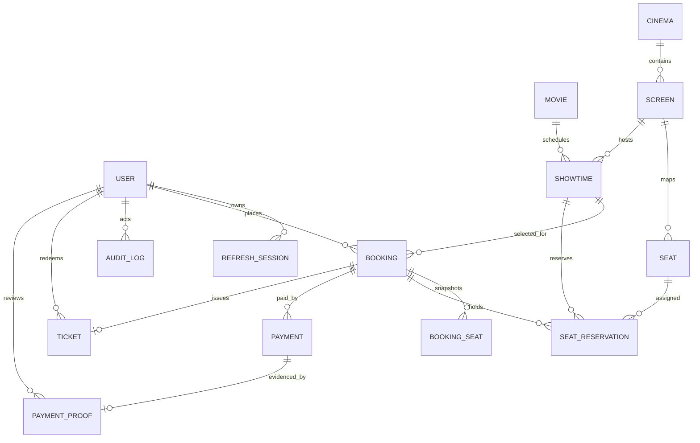

# MovieHub Enterprise Readiness

Audit and implementation snapshot: 13 November 2026. This document supersedes the Phase 1 and Phase 2 checkpoint statements where those describe an earlier runtime state.

## Executive summary

MovieHub now runs as a Vue 3 + Vite frontend and a Node.js + Express modular monolith. Runtime repositories use PostgreSQL through Prisma 7. The main customer path is implemented: catalog → cinema → showtime → seat hold → checkout → ticket QR. Seat holds are server-priced, idempotent, expiring, and protected by serializable transactions plus a PostgreSQL partial unique index. Stripe webhooks are signature-checked and deduplicated. Local development has an explicit mock payment provider.

The user-provided Supabase PostgreSQL database is reachable and the earlier Prisma migrations have been applied, with sample catalog/showtime data plus bootstrap admin/staff accounts seeded. A portable PostgreSQL 16.16 server now also runs locally at `127.0.0.1:5432` with all four migrations, including `payment_proofs`, applied; the Supabase target still needs that migration before production use. The pay-per-title flow generates a dynamic PromptPay QR that embeds the exact amount due, with manual administrator approval; no automatic bank confirmation is configured. MongoDB import/cutover and production deployment have not been run.

## Cinema booking payment

Cinema tickets now support the same manual PromptPay flow as pay-per-title purchases. `POST /payments/promptpay/checkout` creates a `PROMPTPAY` payment, extends the seat hold to two hours, and returns an EMVCo payload with the exact amount. Customers upload a signature-checked PNG/JPEG slip (max 5 MB, SHA-256 deduplicated) to `POST /payments/promptpay/{paymentId}/proof`. Administrators review it in `AdminReview.vue` or through `GET /payments/admin/promptpay/review-queue`. Approval reuses `settlePaymentInTransaction`, so the ticket is only issued while the seats are still held and the amount matches; it is audit logged and rejects duplicate settlement. Rejection marks the payment `FAILED` and stores the note. This still requires human verification of the bank transfer.

## Pay-per-title web viewing (pilot)

The product flow is being shifted to a 50 THB one-time purchase per title. The backend generates a per-purchase dynamic PromptPay QR (EMVCo payload with the amount due); customers upload a PNG/JPEG transfer slip (signature checked, max 5 MB), which enters an admin review queue. Only an admin approval grants the account access. The QR has no bank-side order callback or payment webhook, so this flow does not automatically confirm transfers. The additive `movie_rentals` migration adds purchase review and video asset tables.

Admins can upload MP4 files through `PUT /api/movies/admin/{movieId}/video` (2 GB maximum, signature checked, three uploads per hour per IP). Uploads stay pending until an admin previews and approves them. A separate, short-lived signed playback URL gates byte-range streaming to an approved purchaser. Poster uploads from customers are not accepted. The current movie list contains commercial film metadata/posters only; there are no licensed video files in the repository, so none of those titles can be purchased or streamed until the operator supplies distribution rights and authorized video assets. The rights checkbox is an operator attestation, not an automated copyright check. Local media files live under ignored `backend/storage/videos`; production must configure durable, private object storage and resilient backups before hosting large video files. This access gate is not DRM and cannot prevent screen capture.

## Code and dependency audit

- **Frontend:** `frontend/moviehub-frontend/src` contains Vue pages, Vue Router, Axios, and Tailwind styling. The booking screens now read catalog and availability from the API; the former random seat map and fake showtime schedule were removed from this flow. Access tokens stay in memory; the refresh token is an HttpOnly cookie.
- **Backend:** Express mounts focused `auth`, `catalog`, `cinema`, `scheduling`, `booking`, `payment`, `ticket`, and `health` modules. Prisma is the runtime persistence layer. Mongoose remains only for the optional legacy MongoDB importer.
- **Dependencies:** Prisma and its PostgreSQL adapter are pinned to 7.10.1. `npm audit --audit-level=moderate` reports zero vulnerabilities in both backend and frontend at this snapshot. Frontend build succeeds. Browser compatibility metadata reports that its database is stale; refresh it during routine dependency maintenance.
- **Quality gaps to address next:** no database-backed automated concurrency/integration suite, no production telemetry/alerting, and no automated refund reconciliation. A CI workflow, structured request logging, and a minimal admin console (review slips, create movies/cinemas/screens/showtimes) now exist; update/delete admin operations remain backlog.

## Security audit

### Implemented controls

- HS256 JWT verification pins algorithm, issuer, audience, and access-token type. Refresh tokens are opaque, hashed at rest, rotated once, and delivered only in an HttpOnly cookie.
- Passwords use bcrypt. Registration enforces an 8–128 character password; login responses do not distinguish unknown users from wrong passwords.
- API rate limiting, request IDs, security headers, origin allow-list CORS, JSON size limit, and role checks are in place.
- Booking price and seat identity come from PostgreSQL. Idempotency keys prevent accidental duplicate holds. A unique partial PostgreSQL index prevents two active reservations for the same showtime and seat.
- Stripe webhook signatures are timestamp-checked and compared in constant time. Event IDs are unique per provider. Ticket payloads are signed; only the token hash is persisted. Redemption is an atomic one-time update.
- Mock payment routes reject production mode. Production configuration requires Stripe and prohibits mock payments.

### Remaining security/operations work

- Use managed secrets and TLS in deployment; rotate JWT and Stripe secrets under an operational runbook.
- Add an admin audit trail to write operations and an explicit user/staff role administration workflow.
- Add automated reconciliation and refunds for late payments marked `REFUND_PENDING`.
- Add integration tests for parallel seat holds, refresh-token replay, webhook replay/signature failures, checkout expiry, and ticket double scans.
- Add CSRF review for refresh-cookie endpoints if frontend and API are deployed cross-site; current cookie policy assumes same-site deployment.

## PostgreSQL migration plan

1. Provision separate development, staging, and production PostgreSQL databases; keep MongoDB read-only as the migration source.
2. Set `DATABASE_URL` and source `MONGO_URI` only in protected environment configuration. Do not commit either credential.
3. Run `npm run data:migrate:mongodb -- --dry-run` in `backend`; review counts, duplicate identities, unmapped documents, and legacy bookings.
4. Take consistent backups. Resolve duplicate usernames/emails and invalid references before importing. Legacy bookings without verifiable payment evidence must remain `LEGACY_UNVERIFIED`, never receive active tickets.
5. Apply schema with `npm run prisma:migrate:deploy`, generate Prisma Client, then run importer with `--apply` against staging.
6. Compare entity counts, referential integrity, representative records, and financial totals. Rehearse rollback and cutover with writes frozen or change capture agreed.
7. Cut over runtime to PostgreSQL only after parity approval; retain MongoDB backups through the agreed rollback window.

The initial migration contains integrity checks and the active-seat unique partial index. The later payment-events migration provides webhook idempotency, and the `payment_proofs` migration adds unique slip hashes plus reviewer attribution. Earlier migrations and the idempotent sample seed have been applied to the configured Supabase PostgreSQL database; the `payment_proofs` migration still needs deployment, and MongoDB import remains pending because no source database was configured.

## ERD

`BookingSeat` preserves label and price snapshots even if catalog/screen data later changes. `SeatReservation` is the concurrency boundary. `PaymentEvent` is a standalone provider webhook idempotency log keyed by provider and event ID. `PaymentProof` stores at most one slip per payment with a unique SHA-256 hash and reviewer attribution. `Ticket` stores one active signed token hash per confirmed booking. `LegacyIdMap` maps imported Mongo identifiers without reusing them as PostgreSQL primary keys.

## API specification

The current machine-readable contract is [OpenAPI](api/openapi.yaml). Base path is `/api/v1`; compatibility routes under `/api` remain mounted for the existing frontend.

| Method and path | Access | Purpose |
|---|---|---|
| `POST /auth/register`, `/auth/login`, `/auth/refresh`, `/auth/logout` | Public / refresh cookie | Account lifecycle |
| `GET /movies`, `GET /movies/{movieId}` | Public | Catalog and upcoming showtimes |
| `POST /movies` | Admin | Create movie |
| `GET /cinemas`, `GET /cinemas/{cinemaId}` | Public | Cinemas, screens, seats |
| `POST /cinemas`, `POST /cinemas/{cinemaId}/screens` | Admin | Create venue and seat map |
| `GET /showtimes?movieId=&cinemaId=&date=` | Public | Query showtimes by Bangkok local date |
| `GET /showtimes/{showtimeId}/seats` | Public | Live availability |
| `POST /showtimes` | Admin | Schedule show with overlap check |
| `POST /bookings/holds` | User, `Idempotency-Key` required | Atomically hold 1–8 seats; server calculates amount |
| `GET /bookings`, `GET /bookings/{bookingId}` | Owner | Booking history and detail |
| `POST /bookings/{bookingId}/cancel` | Owner | Cancel pending booking/release seats |
| `POST /payments/checkout` | Owner | Create or resume checkout |
| `POST /payments/promptpay/checkout` | Owner | Create/resume a PromptPay payment and amount-bearing QR; hold extended to 2 hours |
| `GET /payments/promptpay/{paymentId}` | Owner | Payment, slip-review, and booking status |
| `POST /payments/promptpay/{paymentId}/proof` | Owner | Upload raw PNG/JPEG slip (max 5 MB, SHA-256 deduplicated) |
| `GET /payments/admin/promptpay/review-queue` | Admin | List slips awaiting review |
| `GET /payments/admin/promptpay/{paymentId}/proof` | Admin | Private slip image (`no-store`) |
| `POST /payments/admin/promptpay/{paymentId}/review` | Admin | Approve (issue ticket) or reject, audit logged |
| `POST /payments/webhooks/stripe` | Stripe signature | Confirm payment and issue ticket |
| `POST /payments/mock/{paymentId}/confirm` | User, development only | Complete local demo checkout |
| `GET /tickets/booking/{bookingId}` | Owner | Active ticket and QR payload |
| `POST /tickets/redeem` | Staff/Admin | Redeem once at venue |
| `GET /health/live`, `/health/ready` | Public | Liveness and PostgreSQL readiness |

## Prioritized development backlog

### Critical

- Provision separate staging/production databases and smoke-check their runtime configuration; the configured Supabase database has migrations and seed data already.
- Configure production domain, TLS, managed secrets, CORS origins, and Stripe webhook; validate a real test-mode payment and refund path.
- Add PostgreSQL concurrency tests proving no double allocation under simultaneous seat holds and no duplicate ticket under webhook replay.

### High

- Implement operator UI for movies, cinemas/screens, showtimes, booking lookup, and ticket scanning.
- Implement refund provider integration and reconciliation for `REFUND_PENDING`.
- Add CI for frontend build, backend static checks, Prisma validation, dependency audit, and PostgreSQL integration tests.
- Add structured operational logs, metrics, alerting, and backup/restore drills.

### Medium

- Add seat categories and per-seat pricing; validate showtime timezone rules and holiday schedules.
- Add pagination/filtering to cinema/showtime APIs, admin booking filters, and API version retirement policy.
- Add email notifications and booking receipts with delivery retry tracking.

### Low

- Add localization, accessibility review, performance budgets, and image optimization.
- Remove compatibility `/api` aliases after all deployed clients migrate to `/api/v1`.

## Phase roadmap

| Phase | Scope | Status |
|---|---|---|
| 0 | Code/security audit, ERD, migration/API plan, prioritized backlog | Completed in audit checkpoint and this report |
| 1 | Modular monolith foundation, auth/session and middleware hardening | Implemented; see checkpoint note in architecture document |
| 2 | Prisma 7/PostgreSQL schema, migrations, dry-run-first Mongo importer | Implemented; migrations applied to Supabase; Mongo import awaits source database |
| 3 | Catalog, cinemas, screens, showtimes, admin write APIs | Implemented; `/admin/catalog` provides create/read UI, update/delete remain backlog |
| 4 | Seat map, atomic holds, booking history/cancellation | Implemented; concurrency integration tests remain backlog |
| 5 | Checkout, Stripe webhook, mock provider, QR ticket, one-time redemption | Implemented; production Stripe setup and automatic refunds remain outstanding |
| 6 | End-to-end quality, CI, telemetry, admin/staff tools, reconciliation | Next implementation phase |
| 7 | Production deployment, load/security review, cutover and operations | Pending environment provisioning and Phase 6 completion |

## Verification and limits

- Frontend production build: passed.
- Prisma schema validation and client generation: passed.
- Backend and frontend `npm audit --audit-level=moderate`: zero vulnerabilities.
- PostgreSQL connection and migration status: a portable PostgreSQL 16.16 server was installed at `C:\Users\admin\pgsql` and is running on `127.0.0.1:5432`. All four migrations (including `payment_proofs`) are applied to the local `moviehub` database (19 public tables), and the idempotent seed created 15 movies, 2 cinemas, 4 screens, 160 seats, 56 showtimes, one admin, and one staff user. The separately configured Supabase project still needs the `payment_proofs` migration before production use.
- Seed verification: 15 movies, 2 cinemas, 4 screens, 160 seats, 56 future showtimes distributed across the catalog, 1 admin, and 1 staff user; no bookings were created.
- Catalog-to-showtime API smoke check returned 15 movies, a normalized movie ID, two matching cinemas, and selectable showtimes. Local SVG poster fallbacks cover failed external image requests.
- API startup/readiness smoke check returned HTTP 200 with PostgreSQL connected. Admin and staff login/logout smoke checks passed; refresh sessions were revoked afterward.
- PromptPay unit tests: 19 pass via `npm test`, covering EMVCo payload/CRC, identifier normalization, amount formatting, PNG/JPEG slip signature detection, and development CORS origins for both `localhost` and `127.0.0.1`.
- MongoDB import: not run because no source database was configured. The local PromptPay booking flow (hold → QR with amount → slip upload → admin review queue → approval → ticket) was verified end to end against PostgreSQL 16: booking `CONFIRMED`, payment `SUCCEEDED`, proof reviewed, ticket row created, and `PROMPTPAY_PAYMENT_APPROVED` audit log written. Local dev credentials live only in the git-ignored `backend/.env.local` and `backend/admin-bootstrap.txt`.
